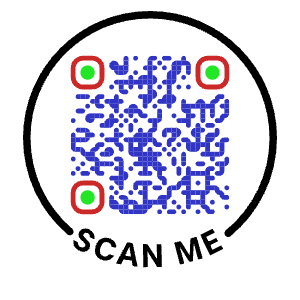

# Tube Scanner

A phone web app that reads the Data Matrix barcode on the bottom of a single rack tube.
Aim the on-screen box at one tube and the value appears, with a button to copy it.

It runs in Safari (or any modern phone browser) and can be added to the home screen
like an app. It needs no App Store, no Apple developer account, and nothing that expires.





## Why the regular reader fails

The tube codes are laser-etched **white on black** (inverted), small, and randomly rotated.
Many scanners only look for dark-on-light codes. This app uses
[zxing-cpp](https://github.com/zxing-cpp/zxing-cpp) (via `zxing-wasm` 3.1.4, vendored in
`vendor/`) with inverted-code detection enabled. On the sample photo `IMG_7767.jpg` it
reads 90 of the 96 tubes from one phone photo.

## Using it

- **Live mode:** tap **Start camera** and hold the tube in the box. It beeps and shows the
  value. Tap **Copy**, then **Scan next**. It won't re-read the same tube until you move on.
  - **Moving the phone:** the value keeps tracking what's in the box. A different tube
    replaces it, with a new beep.
  - **Tube out of view:** after about 0.7 s the value dims and is labelled
    **Last read · not in view**.
- **If the picture is blurry:**
  - **Hold the phone back.** Phone cameras can't focus very close, so hold it about
    15–20 cm away and use **Zoom** (2–3×) to fill the box.
  - **Try another camera.** Phones with several back cameras show a camera picker. Some of
    those cameras can't focus close at all. On Android, `camera2 0` is usually the main
    camera. The choice is remembered on that phone.
  - **Tap to focus.** Tap the tube on screen.
  - **Use the Focus slider** (Android). Drag it until the dots are sharp. **Auto** returns
    to autofocus.
  - **Check the info line.** The small grey line under the status shows the camera, the
    resolution and the focus mode in use.
- **Light:** turns on the flashlight, where the phone supports it.
- **Snap photo:** opens the phone's own camera, which focuses better up close. Take a
  picture with the tube in the middle. The app reads the code nearest the centre.
  Use this if live mode struggles.
- **History:** the last 200 reads on this phone. Tap one to copy it.

## Putting it on the phones

The camera only works when the page is served over **HTTPS**. These files are all static,
with no build step and no server code, so any HTTPS web host works. Upload these files
and folders:

```
index.html  app.js  decoder.js  styles.css  sw.js  manifest.webmanifest  icons/  vendor/
```

Easy options:
- **Internal web server:** copy the files to any folder your IT already serves over HTTPS.
- **GitHub Pages** (free): push the folder to a repository and turn on Pages.
- **Netlify Drop** (free): drag the folder onto https://app.netlify.com/drop.

Then, on each iPhone: open the URL in **Safari**, tap **Share → Add to Home Screen**, and
allow camera access the first time. After the first load it works offline.

**Updating:** edit the files, change `VERSION` in `sw.js` (e.g. `tube-scan-v2`), and
re-upload. Phones pick up the new version the next time the app is opened online.

## Testing

```
node test/decode-sample.mjs
```

This checks the decoder against the sample rack photo and 8 single-tube crops in
`test/fixtures/`. Use Node 18 or later.

## How it works

- `decoder.js` wraps zxing-wasm. `decodeTube()` pads small crops onto an 800 px grey
  canvas first. zxing misses most codes in tiny images, and padding raised the success rate
  from about 40% to about 95% on the sample tubes. It then picks the code nearest the centre.
- `app.js` handles the camera, crops the region under the box about 8 times a second, and
  manages the result, copy and history.
- `sw.js` caches everything for offline use.

## Ideas for later

`decodeAll()` already returns every code in an image with its position, so these can be
built on it:
- Read the whole rack from one photo and map each code to its well (A1–H12), with CSV export.
- Send reads to a LIMS or other system.
- Act as a Bluetooth keyboard into another computer. This needs a native app or a small bridge.
